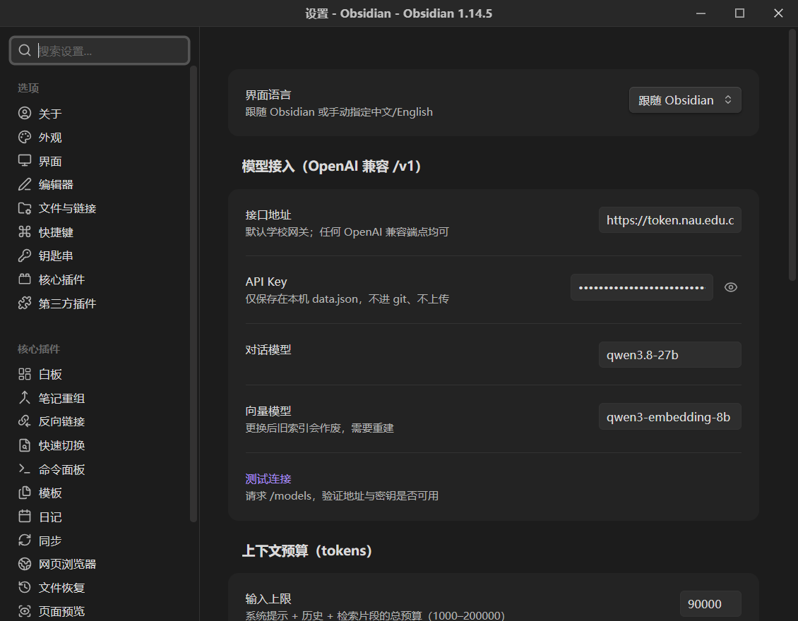
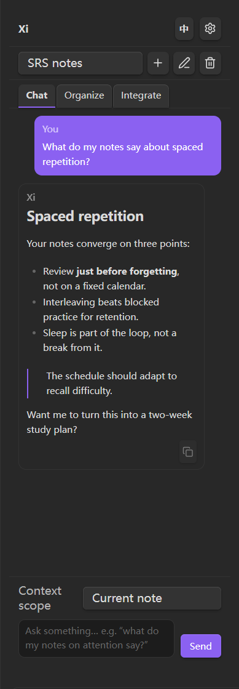
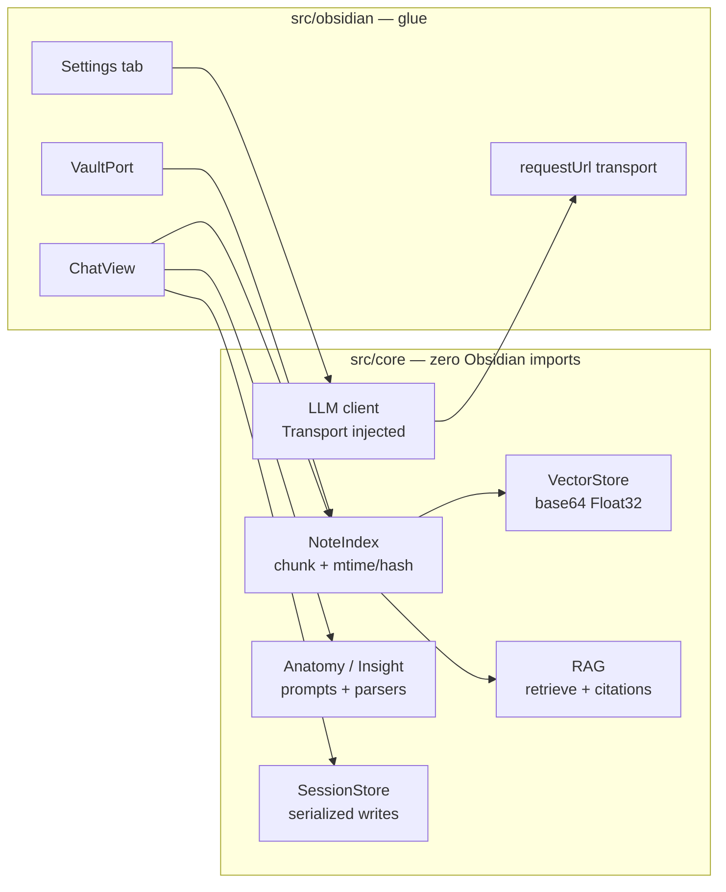

# 希XI · Xi Qwen

**A bilingual (中文 / English) Qwen assistant that lives inside Obsidian — read, organize, and merge your notes without leaving the vault.**

> 双语 Qwen 笔记助手：用你自己的 OpenAI 兼容网关，理解、整理、整合知识库。
> 回答带引用角标，点击直达原文；除你点击确认的写入外，永不静默修改笔记。

[](https://community.obsidian.md/plugins/xi-qwen)
[](https://github.com/zhang66633/obsidian-xi/releases)
[](LICENSE)





## What it does

One sidebar, three tabs:

| Tab | Tools | Writes to your notes? |
|---|---|---|
| **Chat** | Multi-session chat (new / switch / rename / delete, survives restarts); vault-wide Q&A with clickable `[1][2]` citation chips; ask about the current note or a selection; one-click note anatomy (summary / key concepts / open questions); Markdown answers with a copy button | No |
| **Organize** | Related notes (similarity-scored, one-click `[[link]]`), semantic search (chunk-level hits), tag suggestions that prefer your existing tag vocabulary, near-duplicate detection | Tags only — automatically inside whitelisted folders, one click elsewhere |
| **Integrate** | Compare 2–10 notes (consensus / divergence / complementary), merge notes into a structured draft with per-point sources, knowledge-gap analysis | Only when you click “create note” |

UI strings are fully bilingual — switch in the sidebar header or in settings (it can also follow your Obsidian locale).

## Requirements

- **Obsidian 1.13.0+** (desktop or mobile).
- Any **OpenAI-compatible** endpoint with a chat model **and** an embedding model.
  Defaults are pre-filled for a campus gateway (`qwen3.8-27b` chat + `qwen3-embedding-8b`
  embeddings); change the base URL, models, and key in settings. Ollama, LM Studio,
  vLLM, DashScope-compatible mode, one-api/new-api gateways all work.

## Install

**Community directory:** search for **Xi Qwen** in Settings → Community plugins, or open
[community.obsidian.md/plugins/xi-qwen](https://community.obsidian.md/plugins/xi-qwen).

**BRAT (beta):** paste `https://github.com/zhang66633/obsidian-xi` into the BRAT plugin.

**Manual:** copy `main.js`, `manifest.json`, and `styles.css` into
`<your vault>/.obsidian/plugins/xi-qwen/`, then enable the plugin in Settings → Community plugins.

## First run

1. Settings → **Xi Qwen** → paste your API key (stored locally in `data.json`), check the base URL, and click **Test connection**.
2. Command palette → **Rebuild Xi index** (one-time; afterwards it syncs incrementally as you edit).
3. Open the sidebar (ribbon icon) → set context to **Whole vault (RAG)** → ask away.

### Commands

| Command | What it does |
|---|---|
| **Open Xi sidebar** | Focus the chat panel |
| **Ask Xi about selection** | Explain the selected text in the context of the current note |
| **Xi: Understand current note** | Summary + key concepts + open questions for the active note |
| **Rebuild Xi index** | Full re-index (also fills missing embeddings) |

## Privacy and network use

- Notes are sent **only** to the endpoint you configure. There is no third-party service,
  no telemetry, no ads, and no account.
- The API key is stored locally in `.obsidian/plugins/xi-qwen/data.json`; it never leaves your
  machine except in requests to your endpoint.
- The embedding index and chat sessions are cached locally in the plugin folder
  (`cache.json`, `sessions.json`). Deleting them is safe; the index rebuilds.
- The plugin never edits notes silently. Outside whitelisted folders every tag change is a
  suggestion you apply yourself; comparison/merge notes are created only when you click the button.
- No files outside the vault are accessed.

## What's new in 0.5.0

- **Incremental indexing**: unchanged notes are no longer re-read on every edit; a 3-second
  debounce plus mtime checks keep typing cheap.
- **Declarative settings** (Obsidian 1.13 settings search), working language switching,
  and properly clamped token budgets.
- **Markdown answers**, copy button, note anatomy command, and a real “ask about selection” command.
- **More robust networking**: request timeouts, embedding retries on 429/5xx, partial-index
  persistence so one failed batch doesn’t throw away the whole sync.
- **Bilingual modals**, delete confirmation, and a cleaner mobile layout.

## Development

```bash
npm install
npm run dev        # esbuild watch → main.js
npm run build      # tsc --noEmit + production bundle
npm test           # vitest (core logic, HTTP mocked — no network needed)
npm run lint       # eslint-plugin-obsidianmd
npm run check      # lint + test + build
```

**Architecture**



`src/core/` is pure TypeScript: indexing, vector math, RAG, prompt builders/parsers, and the
LLM client with an injected transport. `src/obsidian/` holds views, ports, and settings, so core
logic runs in plain Node and is unit-tested without Obsidian.

**Releasing:** bump all three version files with
`npm version 0.5.1 --no-git-tag-version`, commit, then push a tag equal to
`manifest.json.version`. `.github/workflows/release.yml` runs the checks, generates a build
provenance attestation, and creates a draft GitHub release with `main.js`, `manifest.json`,
and `styles.css`.

Development notes (plan / decisions / pitfalls / test log) live in [`docs/`](docs/README.md).

## License

MIT © Zhe

---

## 中文说明

**希XI** 是一个住在 Obsidian 侧边栏里的双语 Qwen 助手，三个标签页：

- **对话**：多会话管理（新建/切换/重命名/删除，重启后恢复，每个会话记住自己的上下文范围）；
  全库问答带可点击的 `[1][2]` 引用角标；也可以问当前笔记、解释选中文字，
  或一键做「笔记解剖」（摘要 / 关键概念 / 待解问题）。回答按 Markdown 渲染，可一键复制。
- **整理**：相关笔记（带相似度，一键插入双链）、语义搜索（按段落命中）、
  标签建议（优先复用已有标签，白名单文件夹内自动应用）、近似重复检测。
- **整合**：多篇对比（共识/分歧/互补）、主题合并（带来源标注的草稿）、知识缺口分析。

**隐私与联网**：笔记只会发送到你亲自配置的接口；无遥测、无账号、无广告。
API Key 保存在本机插件目录的 `data.json`，索引与会话缓存在同目录，删掉可重建。
白名单外的任何改动都只是建议，点一下才写入；对比/合并笔记只有点「创建」才会落盘。

**安装**：社区目录搜索 **Xi Qwen**；或把 `main.js` / `manifest.json` / `styles.css`
拷进 `<你的库>/.obsidian/plugins/xi-qwen/` 后启用。

**要求**：Obsidian 1.13.0+；任意 OpenAI 兼容端点（需同时提供对话模型与向量模型）。

**开发**：核心逻辑（`src/core/`）零 Obsidian 依赖，可在 Node 下单测；开发文档见 `docs/`。
